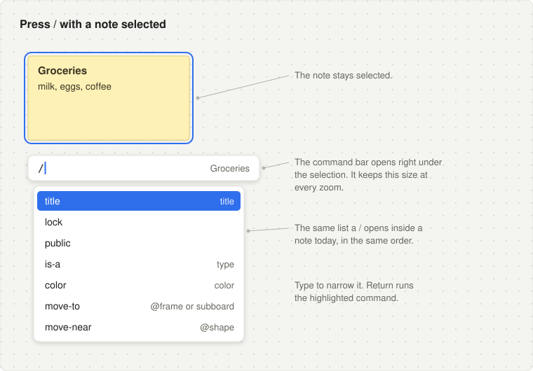
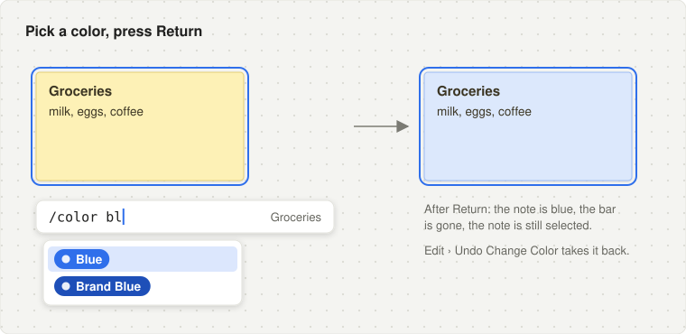
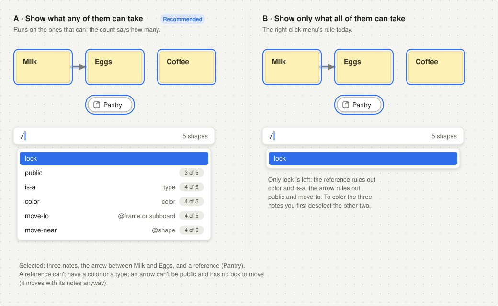
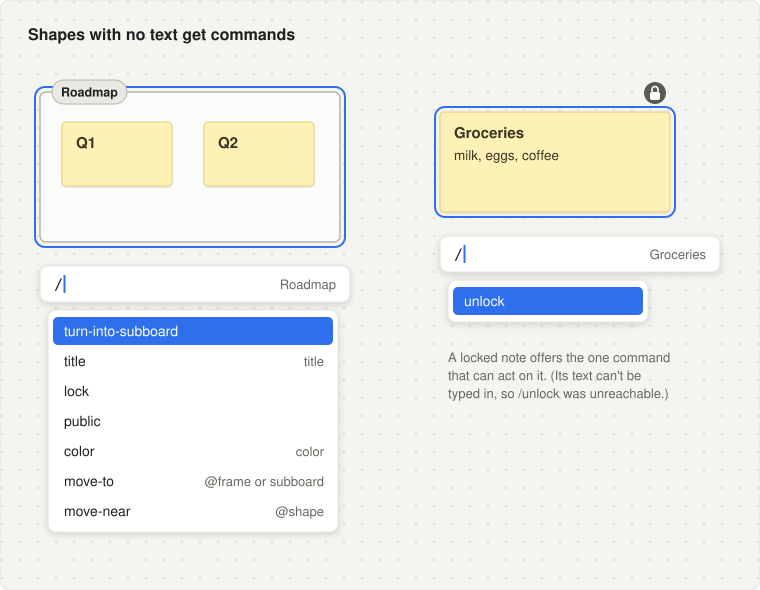
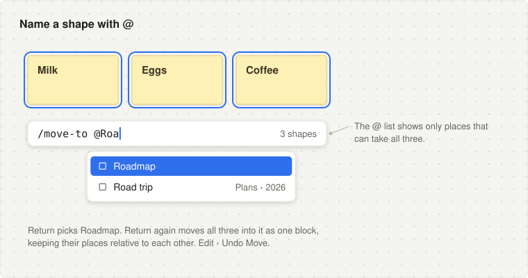
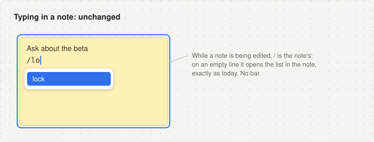
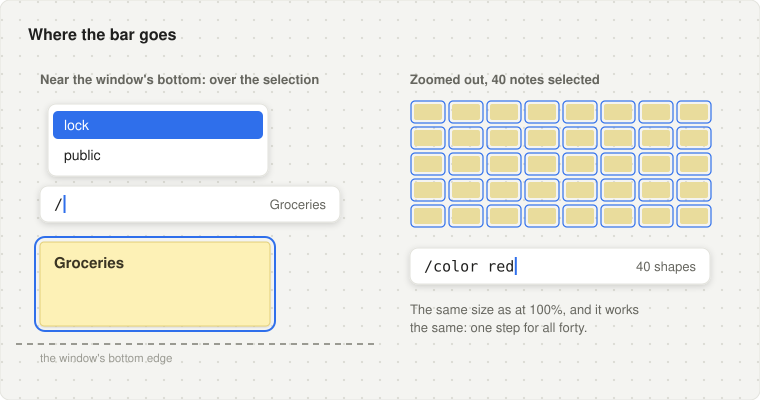

# Slash commands on the selection: the command bar

A plan for the owner's ask of 2026-10-24, in five commits. Each file here is one commit: what it answers, why it's right, and what to do. They're numbered in the order to land them. This was planned in a cloud session without the Swift toolchain, so every plan ends with what to run on the Mac (`./build.sh audit`, `./test.sh`, `./build.sh bench`, the app). Line numbers are from `d368787`. The wireframes are in [`wireframes/`](wireframes), low fidelity.

## The ask

> I have a new direction for slash commands. currently they are only in use on stickies. this is limiting. You can't, for example, do a slash command on a sub-board or a frame, or a reference. i want to make them a function of selection, this will open them up to all shapes. But they still work in stickies.
>
> if you have a sticky selected, and you hit slash, that enters a different mode. beneath your selection you have a slash command that you're typing, similar to today. you hit enter and it executes.
>
> if you are _typing_ in the sticky, then you have the same behavior as today.
>
> That means that if have two nodes selected and you type /color blue it applies to both. If you have 10 selected you can is-a foo andthey all become foo. This will require some logic that is not in place today because some of the selection may not support all the same commands. we need to think this through.

## In short

- **`/` on the canvas, with shapes selected, opens the command bar**: a one-line field just under the selection, holding a `/` and the list today's `/` opens in a note. Return runs the command on the selection, the bar goes, and the selection stays. Typing in a note is unchanged.
- **The engine stops assuming one shape.** A command is typed *for a target*: one shape's text (today's) or the selection (new). Each command says *how it acts on several shapes*: on one only, on each, or on all together. The commands that already take several (Lock, Make Public, Make Private) do so with no change.
- **A mixed selection lists every command any of its shapes can take, and a row says how many it applies to ("4 of 5")**: the owner's call (below).
- **What it opens up:** `/turn-into-subboard` on a frame (typeable nowhere today: `.claude/rules/transform.md`), `/unlock` on a locked shape (unreachable from text: `.claude/rules/locking.md`), `/color` and `/is-a` on many shapes at once, `/move-to` of a whole block (`.claude/rules/moving.md`, "Not built: moving several selected shapes with a command"), and every command on frames, subboards and references, which have no text to type in, and on an arrow without editing its label.

## What it looks like

The list under the bar is the app's one caret list (TextEditing's `CaretListWindow`), as it is in a note today.

**Press `/` with a note selected.** The bar hangs under the selection, left edges together, the same size at every zoom; at its right, what it acts on. (`move-to` and `move-near` join the list in [05](05-shapes-named-in-the-bar.md).)

**A command that takes a choice.** Exactly today's second list, in the bar instead of on a line of the note.

**A selection of several kinds.** What ships is the left: every command any of them can take, counted where it applies to fewer than all.

**Shapes with no text, and a locked shape.**

**Naming a shape** ([05](05-shapes-named-in-the-bar.md)).

**Typing in a note: unchanged.**

**Where it goes.**

**How it comes and goes.**

- **Opens:** `/` on the canvas while shapes are selected and nothing is being edited, if the selection offers a command. Otherwise `/` does what it does today.
- **While open:** typing narrows the list; ↑ ↓ move; Tab, or Return on a command that takes something, completes it and opens its choices (or waits for its text, or an `@`).
- **Runs:** Return. The bar closes first, then the command runs on the shapes it applies to, as one undo step.
- **Closes without running:** Escape (once to close a list, again for the bar), ⌘., deleting the `/`, a click elsewhere, the selection changing, another board, Undo.

## Decided

**What a mixed selection lists** (the owner's call, 2026-10-24): every command any of the selected shapes can take. A row says how many shapes it applies to when that's fewer than all ("4 of 5"); Return applies it to those and leaves the rest as they are. The right-click menu keeps its own rule, only what every shape takes (`Sources/ContextMenus/Resolution.swift:165`): a menu shows what applies to all, unasked, while a typed command says what you want, and a marquee picks up the arrows and references around the notes you meant.

The plans also settle these, each where it's built; say if any should change:

- **Each command says how it acts on several shapes**: on one only, on each, or on all together. Commands written today stay one-shape until their plugin says otherwise; an edit acts on each; a declared command (Lock, Make Public) on all together, as it already does. Running a one-shape command on each shape would break `/move-near` (the shapes land one by one, not as a block) and nested `/turn-into-subboard` ([01](01-targets-in-the-engine.md)).
- **A locked shape** is offered only the commands whose own rule can act on it (`/unlock`), so no row can only be refused ([01](01-targets-in-the-engine.md)).
- **`/title` stays one shape's**: a title tells a shape apart, and ten shapes with one title are ten paths alike, which Boards warns of ([02](02-shipped-commands-on-several-shapes.md)).
- **The bar is a core card**, as a row's card is, with one new flag so it shows when zoomed out ([03](03-cards-shown-zoomed-out.md), [04](04-the-command-bar.md)).
- **It closes when the selection changes or its field loses the keyboard**, so it never acts on shapes it wasn't opened for ([04](04-the-command-bar.md)).
- **No right-click item for it, for now**: the key is in the Keyboard Shortcuts window, and an item would cost SlashCommands an import of ContextMenus ([04](04-the-command-bar.md)).
- **Naming a shape in the bar** (`/move-to @…`) uses Mentions' text, through a point the bar declares, since SlashCommands can't import Mentions ([05](05-shapes-named-in-the-bar.md)).

## The model

### A target

`SlashTarget`: what a command line is typed for.

- `.text(owner)`: a line of one shape's text, as today (a note's words, an arrow's label, a panel's box). The shape is being written, so it is never read-only, and `commands(for:)` offers nothing on a read-only one (as now).
- `.selection(ids)`: the bar. The selected shapes, in selection order (`editor.selectedShapeIDs`): a group selected whole is its shapes, and a frame is itself, not what it holds.

### How a command acts on several shapes: its reach

`SlashReach`, the command's own, said where it is registered:

| Reach | What it does on several | Whose default |
|---|---|---|
| `one` | Nothing: it's listed only when the target is one shape (a text's line, or a selection of one). | A `perform:`, `shapes:` or `choices:` command as written today, so nothing becomes plural by accident. |
| `each` | Runs on each shape it reaches, one at a time, in one transaction and one undo step. | An `edit:` command: an edit is over one shape's value by nature. |
| `together` | Runs once, handed all the shapes it reaches. | A declared command (`SlashCommand("lock", command: .lock)`: its rule and its run already take a `CommandSubject` of many), and the new plural forms (`SlashCommand.together(…)`) for what must be done as one: a block moved, nested frames turned innermost first, one type given to many. |

### Which commands a target lists

`SlashCommandState.commands(for:)`, the one place this is decided:

1. For each shape of the target, the commands its kind offers (its own, then the scopes' in plugin order, as today), each whose `when` holds of the shape. A read-only shape (`editor.isReadOnly`: locked, in a locked frame, on a locked subboard's board) is offered declared commands only, whose rule decides: Unlock acts on a locked shape; nothing else does.
2. A command is its name. The shapes that offer it are its **reach**, in target order. Two kinds' own commands of one name are one row, each running its own on its own shapes (as a context menu item of one key is: `Sources/ContextMenus/Resolution.swift:165`). A choice command whose name is two different commands in one target is left out: two lists of rows can't be one.
3. It's listed if its reach isn't empty (any of the shapes: the owner's call) and: a `one` command only where the target is one shape; a declared command only while its rule can act on its reach (`editor.canPerform(_:on:)`), or by `when` alone with `tries:`.
4. In the order the first shape lists them, then what only later shapes offer, as they list it.
5. A row whose reach is fewer than the target says how many: `3 of 5`.

### Running

As today (`SlashCommandState.run`, `Sources/SlashCommands/SlashCommandState.swift:199`): one undo step, named for the command (its title in words, its `step:`, a declared command's title, a row's `step`), on its reach as found when Return was pressed, `when` not asked again. What a command can't do as a whole it still refuses as it does today: a frame whose turn would move a locked note, a block a locked frame would take. Nothing changes, no step is left, and the refused shapes shake; a declared command's try shakes what it can't change (`/private` on a shape something stands for, as the chip's click does).

## Each shipped command, on several shapes

| Command | Owner | Form today | Reach | On several shapes | Not reached |
|---|---|---|---|---|---|
| `/title` | Titles (`Titles.swift:553`) | `edit` over the record | `one` | Not listed | Kinds with no title |
| `/lock` | Locking (`Locking.swift:130`) | declared `.lock` | `together` | `when: !isLocked`, so the count is exact; Lock locks them | A locked shape |
| `/unlock` (new) | Locking | declared `.unlock` | `together` | `when: isLocked`; Unlock unlocks them. Never in text: a locked shape's text can't be typed in | A shape not locked |
| `/public`, `/private` | Publishing (`PublishMenus.swift:46`) | declared, `/private` a try | `together` | `/public` gains `when: !public` for an exact count; the commands pick out what can change | An arrow, a reference (`NeverPublic`) |
| `/turn-into-subboard` | Transform, for Subboards (`Transform.swift:211`) | `perform` on one shape | `together` | `TransformState.turn(ids, into:)`: innermost first, all or nothing, one step | Every kind but a frame |
| `/color` | Colors (`ColorCommand.swift:46`) | choice, one owner | `together` | The book's names, `None` while any holds a color of its own; `editor.setColor(_:of:)` on all | A reference |
| `/is-a` | Types (`TypeLinks.swift:235`) | choice, one owner | `together` | The rows Is a ▸ lists for a selection (`typeMenuChoices(for:)`, `TypeChoices.swift:107`), less what every one is already; a pick given to those that may take it, one step; `Type` while every one can be a type and none is; New type beside the block, given to all | Frames, subboards, references; an arrow that is an end |
| `/move-to @X` | Moving (`Moving.swift:23`) | takes one shape, for one owner | `together` | As one block, as Move To ▸ moves a selection (`Drop`, `Dropping.swift:41`): kept where they are to each other, one step | An arrow (it rides along when both its ends move) |
| `/move-near @X` | Moving | takes one shape, for one owner | `together` | As one block beside X (`Block`, `Move.swift:48`) | An arrow |

## Order

- [01](01-targets-in-the-engine.md) **Targets in the engine.** `SlashTarget`, `SlashReach`, the plural forms, listing and running over a target. The text surface is `.text(owner)` and nothing in the app changes.
- [02](02-shipped-commands-on-several-shapes.md) **Each shipped command says how it acts on several.** Before any surface can run one on several, so `/title` never renames five shapes. `/unlock` arrives, reachable by no surface until 04.
- [03](03-cards-shown-zoomed-out.md) **A card that shows zoomed out.** One flag in the core, held apart because it's the core's and its tests are CanvasTests'.
- [04](04-the-command-bar.md) **The command bar.** `/`, the card, its field, its keys, VoiceOver, what ships. Commands that take a shape wait for 05.
- [05](05-shapes-named-in-the-bar.md) **Shapes named in the bar.** Mentions gives the bar its field, so `/move-to @…` and `/move-near @…` work on a selection.

01 and 03 are independent; 02 needs 01; 04 needs all three; 05 needs 04.

## Rules the plans write down

1. **A slash command is typed for a target**: one shape's text, or the selection. The engine knows which shapes, never which surface draws the line.
2. **How a command acts on several shapes is its author's to say**: `one`, `each` or `together`. A declared command is `together` by nature; nothing else becomes plural without saying so.
3. **A target lists what any of its shapes takes, and says how many.** Running acts on exactly those, in one step.
4. **A read-only shape is reached only by a declared command, by its rule.**
5. **Typing in a shape's text is unchanged**: the text surface is the one-shape target it always was.

## Considered and not planned

- **Listing only what every selected shape takes**, the right-click menu's rule: the owner chose "any", 2026-10-24.
- **The context menu listing what any shape takes.** It keeps "every": a menu shows what applies to all, unasked, and its items have checks, which "any" would make mixed everywhere.
- **A ring on the canvas round the shapes a highlighted command will change.** The count says how many; the core's tinted outlines (`registrar.outlines`, as Neighbors' lights) could say which. Worth it only if people can't tell.
- **A Run a Command item in the selection's menu**, to teach the key: it would cost SlashCommands an import of ContextMenus. The key is in the Keyboard Shortcuts window.
- **One registry for menu items and slash commands.** Colors contributes Color ▸ and `/color`, Locking Lock and `/lock`, each twice. Declared commands already share their rule and run; the rest stay two contributions. The bar makes the overlap more visible, and a later plan may derive one from the other.
- **`/` with nothing selected**, and **`/` in the table of contents**, whose rows are a selection too: later, once the bar has settled.
- **Recalling the last command** (keyboard navigation's P12, "the last thing done can be done again"): ↑ on an empty bar could bring back the last line run. Small, and better judged after use.
- **Renaming several shapes at once** (`/title Draft 1…n`).
- **A command across boards.** A selection is on the board shown; the commands that move shapes elsewhere (`/move-to` a subboard) already do.
- **SlashCommands in parts** (`Engine`, `Text`, `Bar`). The module grows by the bar; parts would hold the engine's sources apart from the bar's, but not its imports, which are the module's. Worth it if the module passes the size Types was split at.

## Each plan's shape

**Commit title** · **Depends on** · **The ask** (the part of it the commit answers) · **Justification** (what the code and docs show, with file:line) · **Tactics** (code, `Package.swift`, tests and docs, in order, including the topic files CLAUDE.md requires in the same commit) · **Verification** · **Risks and open questions** · **Not in this commit**.
