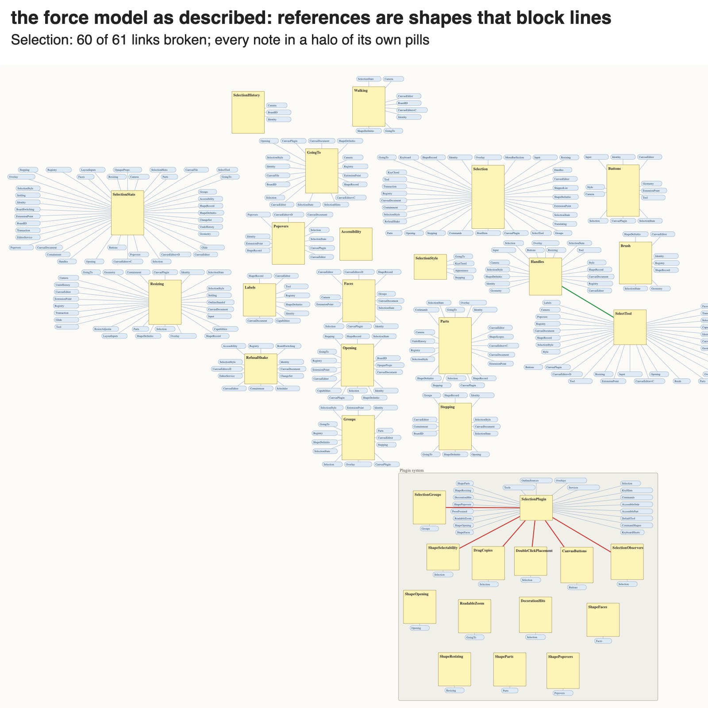
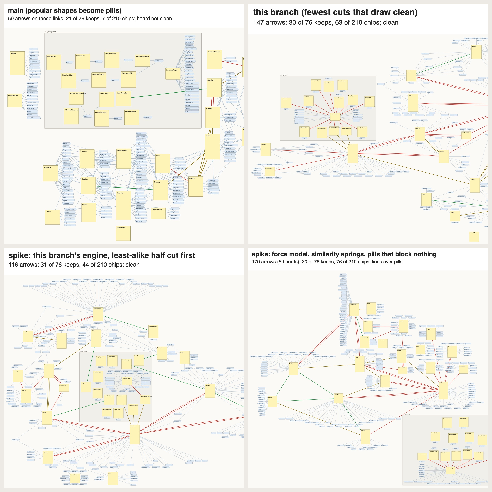
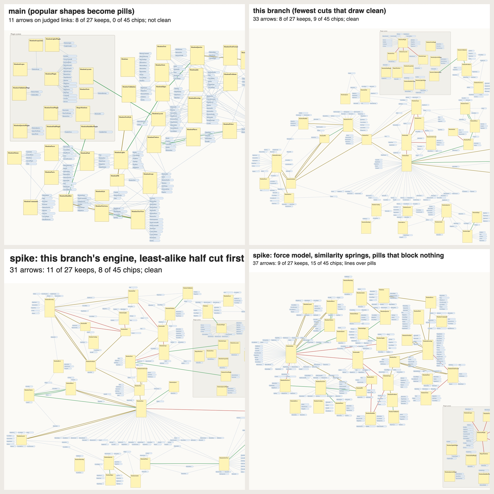

# Spike: let meaning decide which links are arrows

**Verdict.** The signal has legs. The force placer, as tried here, does not. Neither engine we have can use the signal yet.

- **The signal is strong.** How alike two notes' texts are (on-device embeddings plus word overlap) separates the links a person would keep side by side from the ones they would turn into references. It scores an AUC of 0.79 against two blind judges. AUC is the chance a "keep" link outranks a "chip" link: 0.5 is a coin flip, 1 is perfect.
  - The judges, scored against each other, reach 0.99.
  - Main's popularity rule scores 0.59.
  - The layout branch's arrows score 0.55, close to chance.
- **The engines don't use it.** With the same number of arrows, choosing them by similarity alone would keep 57% of the links the judges keep, against the branch's 39%. It would draw 20% of the links they chip, against 30%.
  - Both engines decide which links survive by geometry or popularity.
  - Ranking by meaning changes little until meaning decides first.
- **The force model collapses here.** It fails on this corpus because references are shapes that block lines:
  - 70% of links go to another board.
  - Each of those is a pill with a line.
  - So every arrow is crowded, and the model breaks nearly every link.

This is a spike: evidence and a pre-plan, no feature work. Ultimately it is meant to replace both strategies: main's (popular shapes become pills) and the layout branch's (`claude/canvas-layout-strategy-f81c7d`, slices 1 to 4, not landed: the fewest cuts that draw every board clean).

## Why

A dense graph drawn with every link as an arrow is a ball of mud. The canvas's answer is the reference: a popular shape need not sit beside everything that links to it, because a pill can stand for it, even from another board. Which links should stay physical, though?

- Main says: links to popular shapes become pills.
- The layout branch says: the fewest links that let the board draw with no crossing.

Neither reads like a person looking at the graph and deciding what makes sense, because a person decides by what things mean. An agent in the layout loop would decide better, but it would be neither fast nor deterministic. Embeddings bring in some of the meaning without the agent.

## The strategy tested (the owner's)

1. Draw the graph with every link inside a container as an arrow. Links between boards (and, as first stated, into and out of frames) are references.
2. Find crowded areas deterministically.
3. There, similarity acts on each arrow's spring: alike notes pull hard, unalike ones weakly.
4. Past a threshold the arrow breaks and becomes a reference.
5. References count for little in the layout's repulsion.

## How it was measured

- **Corpus.** This repository drawn by canvas-ingest. It has 72 boards, 891 notes, 56 frames and 71 module cards. Of its 8,282 links, 2,498 are inside a board and 5,784 go between boards.
- **Vectors.** Each note's text is its title plus the doc comment and declarations the lens gives it, with code names split into words.
  - The text is embedded on this Mac with Apple's NaturalLanguage, in two ways: the sentence embedding, and the contextual embedding with its token vectors averaged. Both are 512 numbers, and both are centred on the corpus mean.
  - TF-IDF word overlap is computed alongside.
  - All 1,018 texts, with both models, took 20 s.
- **Blind judges.** Two independent Claude Sonnet agents labelled every one of the 459 links on five dense boards: Selection, Mentions, Draw, Canvas/Model and References.
  - The labels are 0 (incidental: a chip is better), 1 (either) and 2 (one idea: keep them side by side).
  - The judges saw only the notes' text, never a score.
  - They gave the same label 81% of the time (Cohen's kappa 0.68).
  - "Keep" means a mean label of at least 1.5 (76 links). "Chip" means both said 0 (210 links).
  - Both judges picked their 1s and 2s and left the rest at 0, so the labels are coarse.
- **One ruler.** Every strategy writes canvas-digest's drawing format, and every drawing is scored by the layout branch's own health check (crossings, lines over shapes, shapes on top). So main, the branch and the spike are measured alike.

## Results

### 1. Similarity carries the judgment

The table gives each ranker's AUC: the chance a "keep" link outranks a "chip" link. 0.5 is chance.

| ranker | AUC |
|---|---|
| one judge against the other | 0.99 |
| similarity: contextual + word overlap | **0.79** |
| word overlap (TF-IDF) | 0.78 |
| contextual embedding (on-device) | 0.76 |
| sentence embedding (on-device) | 0.73 |
| similarity with a small hub penalty | 0.80 |
| hub penalty alone (the busier end's links on the board) | 0.68 |
| popularity: the busier end's in-degree (main's idea) | 0.59 |
| link weight: how many uses | 0.52 |
| main's drawing (arrow or not) | 0.62 |
| the layout branch's drawing (arrow or not) | 0.55 |

The nearest notes are sensible. On the Selection board, Faces.swift's nearest are ShapeFaces (0.72), Buttons, Popovers and Parts. Its farthest is the `selection` plugin hub. Across all boards, linked pairs score above unlinked pairs on the same board (AUC 0.64 to 0.73 by model).

### 2. Neither engine draws by meaning

These are arrows on the 459 judged links. "Similarity alone" draws the same number of arrows on each board, the most alike links first, with no regard for whether the drawing can hold them.

| | arrows | keep links drawn | chip links drawn | of its arrows: keep / chip |
|---|---|---|---|---|
| main | 59 | 21 of 76 (28%) | 7 of 210 (3%) | 36% / 12% |
| similarity alone, same count | 59 | 30 (39%) | 9 (4%) | 51% / 15% |
| layout branch | 147 | 30 (39%) | 63 (30%) | 20% / 43% |
| similarity alone, same count | 147 | 43 (57%) | 41 (20%) | 29% / 28% |

Why each engine misses:

- **The layout branch.** Its cut keeps the heavier link first, then the one at the busier end, so that a hub keeps its arrows. That is the opposite of what both judges did: they chipped registration lists, style files and shared state.
- **Main.** It is sparse, so its few arrows are better ones. Its boards aren't clean (below).

### 3. The force model as described collapses on this corpus

The spike's force model works like this:

- Notes are footprints, each a note plus its own pills in strips. The strips are the layout branch's `stripAlts`, so no line from a note runs over its own pills.
- Shapes push apart. A pill takes room but adds nothing to the push.
- Every arrow is a spring that wants a 160-unit gap, and gravity holds the board together.
- Shapes are pushed out of arrow corridors, and overlaps are removed.
- In crowded areas, a spring is as stiff as its two notes are alike.
- Each round, the least-alike 10% of crowded links break into pills, and the board settles again.
- At the end, a broken link whose straight line is clear becomes an arrow again, the most alike first.

It is deterministic: no randomness.

**It fails because references block lines.** Each note carries about 6.5 pills for links to other boards. Any line that runs over a pill counts as crowded. So the loop keeps breaking until almost nothing is left: on Selection, 60 of its 61 links break, and the last of them ranked 0.98 by similarity. Corpus-wide, 44 of 72 boards end clean with 496 arrows, and 54% of those on the judged links are links the judges chip. Sharing a pill among the notes that use a target, with pills as light nodes, didn't help either: the crowded lines into shared pills split off until almost no shares were left.

**With pills that block nothing,** taking "references count less" literally, it keeps arrows again, and the semantic order beats a structural control:

| force model, pills block nothing (five judged boards) | arrows | keep drawn | chip drawn | of its arrows: keep / chip |
|---|---|---|---|---|
| least alike breaks first (the owner's rule) | 170 | 30 (39%) | 76 (36%) | 18% / 45% |
| control: the most crowded breaks first | 189 | 21 (28%) | 96 (46%) | 11% / 51% |

**But no judged board ends clean** (lines over pills, and a few crossings). And a link between unalike notes that nothing crowds is never tested, so it stays an arrow. Adding the threshold everywhere made it no better: links cut by meaning where a container has more than 1.5 links a child, and every spring as stiff as its two notes are alike. Then 47% of its arrows are chips. The crowding still breaks the alike links, because a force layout doesn't produce drawings with few crossings.

Corpus-wide numbers for the force model are in the table under 4.

### 4. Similarity inside the layout branch's engine

First the engine is left as it is, and each link's `layout.weight` is set to its similarity rank on its board (1 to 100). The weight already orders the planar cut, the mend's ties and the put-back, and the star placement weighs it in where notes go. Then three small patches (`engine.patch`):

- the mend breaks the least alike link first;
- links are cut by meaning before layout;
- those cuts are kept from being put back.

| corpus-wide (72 boards) | arrows | clean | crossings | over shapes | own lines | area (M) | judged: of its arrows keep / chip |
|---|---|---|---|---|---|---|---|
| main | 659 | 7 | 10,605 | 5,661 | 7,401 | 390 | 36% / 12% |
| layout branch | 1,067 | 72 | 0 | 0 | 10 | 934 | 20% / 43% |
| branch + similarity as weight | 1,073 | 72 | 0 | 0 | 12 | 1,055 | 18% / 39% |
| branch + least alike first in the mend | 1,077 | 72 | 0 | 0 | 12 | 1,055 | 18% / 39% |
| branch + **the least-alike half cut before layout** | 898 | 72 | 0 | 0 | 10 | 852 | **27% / 38%** |
| branch + cut by density (1.5 links a child) | 993 | 72 | 0 | 0 | 11 | 982 | 22% / 35% |
| branch + the half cut, never put back | 726 | 72 | 0 | 0 | 12 | 852 | 27% / 36% |
| force model, pills block lines | 496 | 44 | 0 | 52 | 1,321 | 635 | 18% / 54% |
| force model, pills block nothing, least alike first | 1,074 | 21 | 131 | 1,037 | 2,760 | 695 | 18% / 45% |
| same, control: most crowded first | 1,135 | 22 | 143 | 947 | 2,794 | 650 | 11% / 51% |

Main's health is measured with the branch's straight-line check, which main never aimed at, so treat its crossings as rough.

**Ranking alone changes almost nothing.** As a weight, similarity orders only the planar cut, which makes 391 of 1,449 cuts. The mend makes the other 1,058: the link in the most conflicts goes first, so meaning only breaks ties. Putting meaning first in the mend changed nothing on the judged boards. The likely reason is that the links the star placement can't draw clean are cut before the mend runs, so the placement decides there.

**Cutting by meaning first helps.** Every board stays clean, the area is smaller, and arrows that are chips fall from 43% to 35–38%. But that is still well short of what similarity alone would choose (22% at that count): the engine's geometry still decides which of the remaining links survive.

### 5. Frames: the links into them matter most here

24 of the 76 keep links cross a frame's edge, against 1 of the 210 chip links. The lens puts every extension point and plugin in a "Plugin system" frame, away from the files that declare them. Of those 24 links, 14 join an extension point to the file that declares it, and 9 join a plugin to a file. A rule that makes every link into or out of a frame a reference would cut a third of the links that matter most on these boards. The layout branch's slice 4, which draws links into frames as arrows, was right.

### 6. Meaning is not role

A module's entry file lists every name the module declares, and its style and state files carry the module's own name. So word overlap ties them to every file on their board, and their links survive. The chip-judged arrows left in the best clean run gather at such files, and at plumbing: of the 44, DrawPlugin is at the end of 7, Selection of 4, Identity of 4 and MentionStyle of 3.

Three ways to fix it:

- A hub penalty (the busier end's links on the board) adds a little: 0.79 to 0.80.
- Counting a word for less when the whole board uses it would likely help more.
- The lens could declare a role, such as registration or plumbing.

22 notes have no text at all (11 of them plugins), and these embed by their title alone.

## Pictures

Each picture shows one board under each strategy. Every arrow is coloured by the judges:

- green: both say keep side by side;
- red: both say chip;
- amber: in between.

Pills are blue, and pale lines go into pills. The pictures are drawn from each drawing.json as the health check reads it, so they show the geometry; they are not app captures.

## Pre-plan: one engine where meaning picks the arrows

The rule to build: a link is an arrow when its two notes belong together, and a reference when they don't. The board's complexity sets how many arrows it gets, and geometry only vetoes.

1. **Meaning as an input.**
   - The app computes a vector for each note when it measures it (`canvas measure`): on-device `NLContextualEmbedding`, its token vectors averaged, together with word overlap.
   - Vectors are cached by the note's text, so a redraw embeds only what changed.
   - The tool reads a similarity for each link, and decides by rank within a container, ties by key, so float noise doesn't flip decisions.
   - The vectors, or the ranks, are kept in the drawing record, so an unchanged note keeps its decision through an OS update that changes the model.
   - The lens's job is to give every note text that says what it is. A title alone embeds poorly.
2. **Meaning picks, complexity sets how many.**
   - Each container gets a budget from its complexity. The spike tried two: 1.5 links a child, and half.
   - Its links are ranked by similarity, with words the whole board shares counted for less, and a small hub penalty.
   - The most alike are kept up to the budget, and the rest are references.
   - Arrows into frames stay.
3. **A placer that serves the cut.**
   - Alike notes are placed near each other, so the chosen arrows are short. The branch's star placement already weighs a link's weight in where its notes go, which is a start.
   - Where a chosen arrow can't be drawn clean, the veto cuts the least alike link in the conflict, not the one in the most conflicts. That is the owner's threshold.
   - The target is the ceiling in result 2.
4. **References that don't crowd.** 70% of links go to another board, and each becomes a pill with a line: about 6.5 for each note. That is what made the force model collapse and what forces the branch to cut good arrows. The owner decides among:
   - (a) a note's references as chips inside the note, with no separate shapes and no lines, which would make the force model workable;
   - (b) one pill for each target module rather than for each file;
   - (c) references under a similarity floor left undrawn, though still queryable.
5. **Redraws.** An unchanged note keeps its vector, its ranks and its cut. A person's moves are pinned in the placer, as slice 5 decided.

**The test bed.** The 459 judged links become a fixture. Recall of keep links and the share of chips can't regress, every board must stay clean, and arrows and area are reported. The target is similarity alone at the same count.

**The order.**

1. Similarity in `canvas measure`, and the tool reading it, with no change in behaviour; plus the agreement report.
2. The meaning-first cut in today's engine: the spike's pre-cut, with arrows into frames kept.
3. The references decision, then the build.
4. The placer that serves the cut, measured against the ceiling.
5. Redraws with the new cut.

## Open questions for the owner

1. How should references look so they don't crowd: chips inside the note, one per module, or hidden under a floor?
2. Frames: keep arrows into frames, as the evidence says, rather than "references at frames"?
3. The budget rule: links a child, a fixed share, or planarity?
4. On-device embeddings are deterministic and offline. Is that enough, or is a stronger model (a code embedding through an API) worth losing both? The models differ little here (0.73 to 0.79), and the mix is best.
5. Hubs: a role the lens declares, or a degree penalty?

## Caveats

- The judges are language models, not the owner. Their labels are coarse, they covered five boards, and there is one corpus, a codebase; prose would embed better.
- The pictures are schematic.
- Main is measured by the branch's straight-line check.
- The force model had a few hours of tuning, so a better placer might do better.
- The spike's runs used the layout branch's tool with its uncommitted slice 5 work, which plans a fresh document byte for byte as slice 4 does. `reproduce.sh` uses slice 4 as committed.

## Reproduce

Everything is in this folder:

- `data/`: the corpus as canvas-ingest drew it (`graph.json`), the app's measure of it (`measure.json`) and the kinds (`kinds.json`). `texts.mjs` and `embed.swift` make the texts and vectors again.
- `judge/`: the judges' input, their labels and their scripts.
- The scripts:
  - `texts.mjs` and `embed.swift`: the vectors.
  - `sim.mjs`, `check-sim.mjs`, `eval-judge.mjs`, `agree.mjs`, `ceiling.mjs` and `combo.mjs`: the measures.
  - `semlayout.mjs` (the force model, with `--light`, `--simk` and `--precut`) and `semlayout2.mjs` (shared pills).
  - `semweights.mjs`: similarity as weights for the branch's engine. `engine.patch` holds its three spike changes.
  - `score-drawing.mjs`, `render.mjs`, `compose.mjs` and `stitch.swift`: health and pictures.

The scripts import the layout branch's canvas-digest tool (`DIGEST_TOOL`, its `lib/` folder; commit 4bc3494e on `claude/canvas-layout-strategy-f81c7d`, a local branch). `reproduce.sh` runs every measure above and draws the pictures again. If swiftc says the SDK isn't supported, set `SDKROOT` to one that matches the compiler, as the repository's build notes say.
