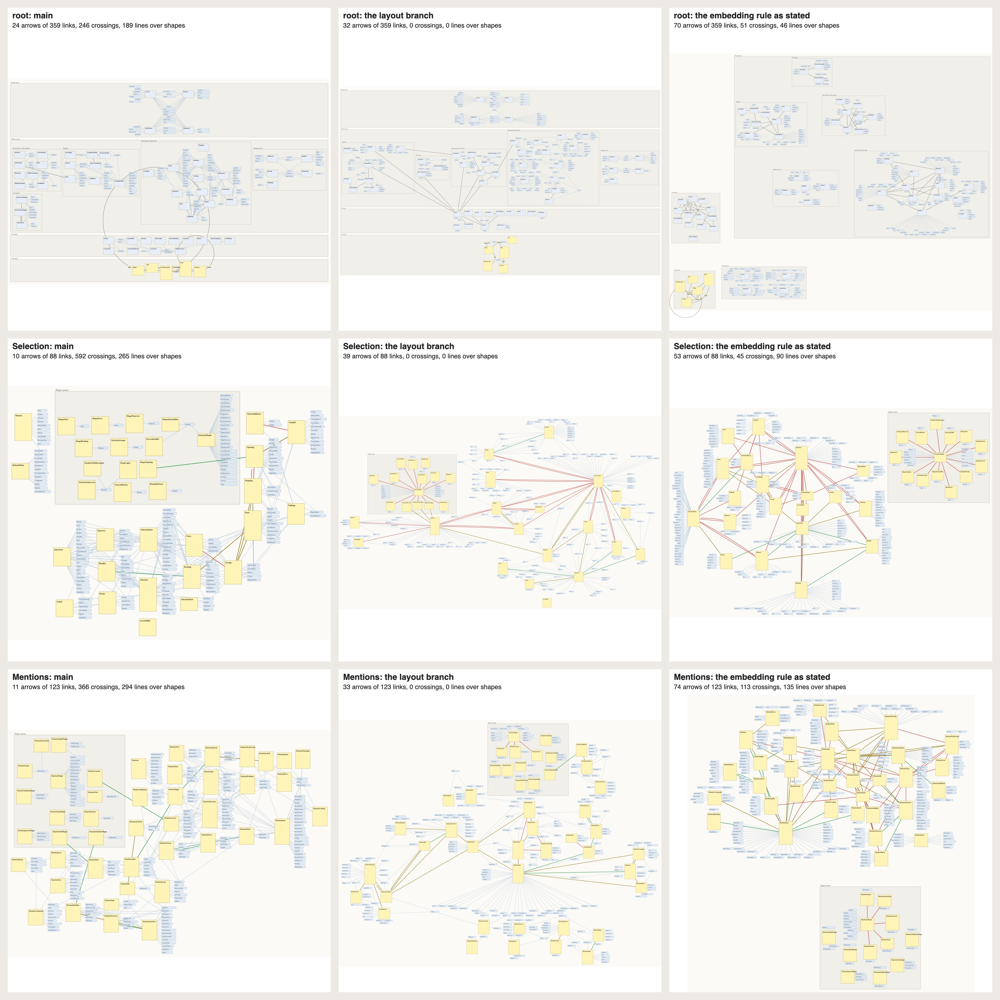
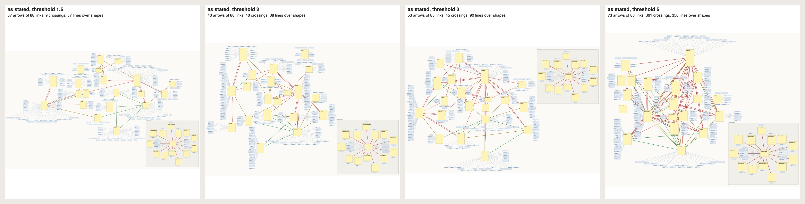
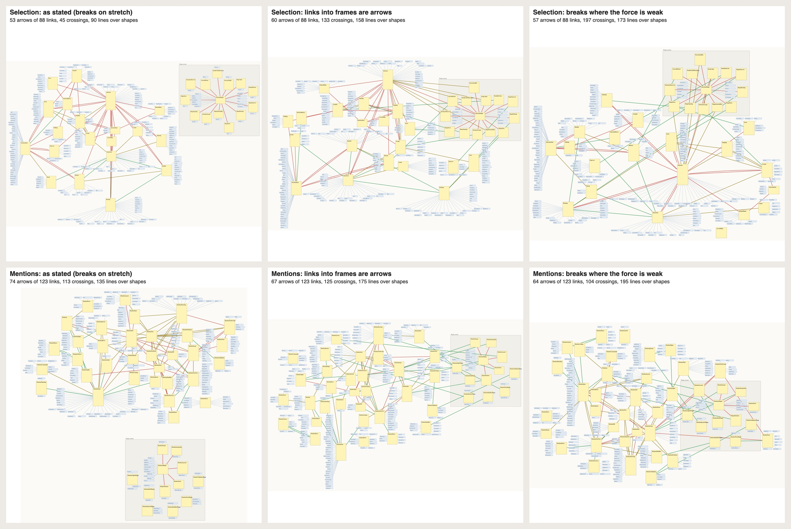
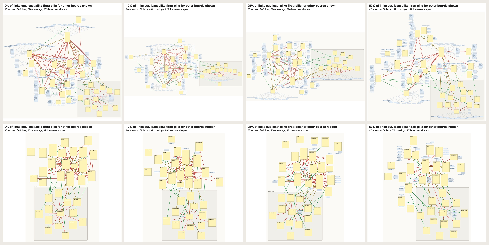
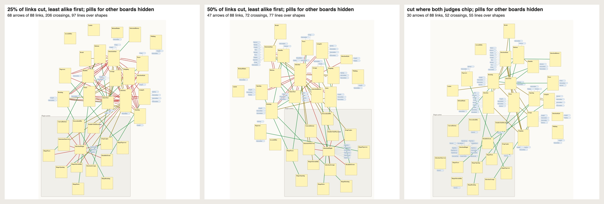

# Spike: let meaning decide which links are arrows

**Verdict.** Built the way the owner stated it, the strategy doesn't have legs as a layout engine. Its embedding half does, as the rule for which links stay arrows.

- **It keeps a graph.** It cuts 43% of the links inside boards; the layout branch cuts 57%, main 74%. Across the 72 boards it draws 1,431 arrows, against the branch's 1,067 and main's 659.
- **But it keeps the wrong arrows, and doesn't draw them clean.** Two blind judges labelled five boards. There, 51% of the strategy's arrows are links both judges would make a chip, and 13% are links they would keep side by side. Main's arrows are 12% chips and 36% keeps; the branch's are 43% and 20%. Only 16 of the 72 boards come out clean (main 7, the branch all 72), with 1,081 crossings in all (main 10,605).
- **The physics is what fails.** In a dense area, how far an arrow stretches comes from the shape of the graph, not from its own spring. A hub sits in the middle of its spokes, so they never stretch. And read as k-cores, the graph's complexity calls 70% of links congested, yet never a hub's star.
- **Similarity used directly holds up.** Put the threshold on each arrow's force itself, and take what a board shares out of the similarity. Then the judged boards get 161 to 216 arrows: 26–31% are keep links and 35–36% chips, the best-chosen arrows of any engine here. They still cross, 266 to 496 times on those five boards.

This is a spike: evidence and a pre-plan, no feature work. It is meant to replace both of today's strategies: main's (popular shapes become pills) and the layout branch's (`claude/canvas-layout-strategy-f81c7d`, slices 1 to 4, not landed: the fewest cuts that draw every board clean). Its earlier rounds tested a rule of mine instead of the owner's. They are kept at the end for what they measured.

## The strategy, as stated

The owner's words:

> first you draw the graph without any references. And of course, it's very dense. There would be references when things cross subboards or pages or frames or whatever, but in general, no references because of popularity/crowding
>
> Then, for areas that are congested, which would be determined deterministically by something like graph complexity, we would use vector similarity to act as a force on the arrow's edge. If the two shapes are very similar, then the force would be strong. And if the shapes were less similar, they would be weaker relatively. There would be some kind of threshold, at which point the physical arrow would be broken and a reference would be used. References wouldn't count as much in terms of the graph layout algorithm's repulsion

How `springs.mjs` builds it:

1. **Every link is an arrow.** Each board, and each frame inside it, is laid out by a force model:
   - shapes push apart;
   - every link inside the board or frame is a spring that wants a 160-unit gap;
   - gravity holds the board together;
   - shapes step out of arrows' way.

   A link to another board, or into or out of a frame, is a reference from the start. It becomes a pill in its note's strip, with a light spring between the two containers.
2. **Congestion comes from the graph alone.** In each container, the dense part is its 3-core: the largest part where every note links to at least 3 others in it. An arrow is congested when both its notes are in that part. Nothing about the picture decides this.
3. **Similarity is the force.** In a congested area, each spring is as strong as its two notes are alike, by rank among the area's arrows: the most alike pull with the full force, the least alike with a tenth of it. Arrows elsewhere pull with the full force. Similarity is the on-device contextual embedding plus word overlap.
4. **The threshold.** The sentence allows three readings, and all three were built:
   - **stretch**: an arrow breaks when it is stretched past a multiple of its area's typical arrow;
   - **strength**: the same, but the more alike the notes, the more the arrow holds, from a quarter of the limit for the least alike to all of it;
   - **force**: an arrow whose similarity is below a threshold breaks before anything is drawn.

   "As stated" below means strength, because stretch alone breaks links regardless of meaning (point 2 under why it does not work as stated). Under stretch and strength, the most stretched arrow breaks first, one at a time, and the board settles after each break. The typical arrow is measured again each time, so a board that spreads as it gains pills doesn't break by spreading.
5. **References count less.** A note pushes with its own size plus a quarter of its pills'. Pills still take room, so nothing sits on them.

It is deterministic, with no randomness. Crossings are allowed, and nothing is put back. All 72 boards draw in 30 seconds.

## How it was measured

- **Corpus.** This repository drawn by canvas-ingest. It has 72 boards, 891 notes, 56 frames and 71 module cards. Of its 8,282 links, 2,498 are inside a board and 5,784 go between boards.
- **Vectors.** Each note's text is its title plus the doc comment and declarations the lens gives it, with code names split into words.
  - The text is embedded on this Mac with Apple's NaturalLanguage, in two ways: the sentence embedding, and the contextual embedding with its token vectors averaged. Both are 512 numbers, and both are centred on the corpus mean.
  - TF-IDF word overlap is computed alongside.
  - All 1,018 texts, with both models, took 20 s.
- **Blind judges.** Two independent Claude Sonnet agents labelled every one of the 459 links on five dense boards: Selection, Mentions, Draw, Canvas/Model and References.
  - The labels are 0 (incidental: a chip is better), 1 (either) and 2 (one idea: keep them side by side).
  - The judges saw only the notes' text, never a score.
  - They gave the same label 81% of the time (Cohen's kappa 0.68).
  - "Keep" means a mean label of at least 1.5 (76 links). "Chip" means both said 0 (210 links).
  - Both judges picked their 1s and 2s and left the rest at 0, so the labels are coarse.
  - The judges stand in for a person reading the board. Their picks are the target, not something any strategy computes.
- **One ruler.** Every strategy writes canvas-digest's drawing format, and every drawing is scored by the layout branch's own health check (crossings, lines over shapes, shapes on top). So main, the branch and the spike are measured alike.

## Results

### Against main and the layout branch

| all 72 boards | arrows | links inside boards cut | clean boards | crossings | lines over shapes | area (M) |
|---|---|---|---|---|---|---|
| main | 659 | 74% | 7 | 10,605 | 5,661 | 390 |
| layout branch | 1,067 | 57% | 72 | 0 | 0 | 934 |
| **as stated** | **1,431** | **43%** | **16** | **1,081** | **1,572** | **674** |

| five judged boards (459 links) | arrows | crossings | of its arrows: keep / chip | keep links drawn |
|---|---|---|---|---|
| main | 59 | 2,223 | 36% / 12% | 21 of 76 |
| layout branch | 147 | 0 | 20% / 43% | 30 |
| **as stated** | **270** | **475** | **13% / 51%** | **36** |
| as stated, links into frames as arrows | 268 | 667 | 21% / 41% | 56 |
| the threshold on the force: similarity below 0 | 216 | 496 | 26% / 36% | 56 |
| the same, below 0.5 | 161 | 266 | 31% / 35% | 50 |

Main's health is measured with the branch's straight-line check, which main never aimed at, so treat its crossings as rough.

The three boards in the picture compare like this:

| board | main | layout branch | as stated |
|---|---|---|---|
| root (359 links) | 24 arrows, 246 crossings | 32 arrows, clean | 70 arrows, 51 crossings |
| Selection (88 links) | 10 arrows, 592 crossings | 39 arrows, clean | 53 arrows, 45 crossings |
| Mentions (123 links) | 11 arrows, 366 crossings | 33 arrows, clean | 74 arrows, 113 crossings |

### Why it doesn't work as stated

1. **Frames as references cut the links that matter most.**
   - On the judged boards, 39 links cross a frame's edge, and 24 of them are keep links. Only 1 is a chip.
   - That's because the lens puts each extension point and plugin in a "Plugin system" frame, away from the file that declares it.
   - So the rule turns 24 of the 76 keep links into pills before anything is drawn.
2. **The graph decides how far an arrow stretches, not its spring.**
   - In a dense area, where an arrow's two notes end up depends on all their other links.
   - With stretch alone as the threshold, the links that break are no less alike than any other: their mean similarity rank is 0.43 to 0.51 on Selection, where 0.5 is chance.
   - It also has no middle ground: on Selection, a threshold of 1.75 breaks 5 links, and 1.5 breaks 48.
3. **Hubs never break.**
   - A force layout puts a hub in the middle of its spokes, so its arrows are short and never stretch.
   - Worse, a star has a core number of 1, so the k-core doesn't call it congested at all. On Selection, `SelectionPlugin`'s 13 registration spokes inside the frame are never tested.
   - Those spokes, and the links into the module's own `Selection` and `SelectionState` files, are what both judges chip most. They stay as the red stars in every picture.
   - Making the break point depend on similarity too (the strength reading) helps: the links it breaks have a mean similarity rank of 0.30. But of the 150 it breaks on the judged boards, 47% are chips, about the same as the 46% of all judged links, because it never reaches the hubs.
4. **Graph complexity barely narrows where meaning acts.** The 3-cores hold 70% of the links inside containers (1,179 of 1,694 pairs). On Selection, 50 of the board's 61 links are in its 3-core.
5. **The placer ignores the lens.**
   - The force model knows nothing of the lens's rows, so on the root the rungs' frames lose their order.
   - Drawing links into frames as arrows fails on the root too. There the frames hold nearly every card, so the links between two layers become one spring between their two frames.
   - The result is 349 arrows drawn where the layout never pulled their ends, with 9,460 crossings.

The threshold sets how many links break. On Selection it leaves:

| threshold | arrows (of 88) | crossings |
|---|---|---|
| 1.5 | 37 | 9 |
| 2 | 46 | 46 |
| 3 | 53 | 45 |
| 5 | 73 | 361 |

At every setting, the hub stars stay.

### What holds up: similarity as the threshold

- **Taking out what a board shares** makes similarity rank links more like the judges.
  - The embedding is centred on its board's mean, and a word counts by how few of its board's notes use it. So a module's own name, which runs through all its files, ties nothing together.
  - Against the judges, the mix scores an AUC of 0.82 (0.79 before), and word overlap alone 0.84 (0.78 before). The embedding alone does a little worse, 0.74 against 0.76.
- **The threshold goes on the force itself.** An arrow whose two notes are less alike than the threshold breaks before anything is drawn, and arrows into frames are kept.
  - At a threshold of 0, the judged boards get 216 arrows: 26% are keep links and 36% chips.
  - At 0.5 they get 161 arrows: 31% keep links and 35% chips.
  - That beats the branch (20% keep, 43% chips) and the rule as stated (13% and 51%). It draws 50 to 56 of the 76 keep links, against the branch's 30.
- **It still crosses,** 266 to 496 times on the five boards. And the registration star inside the frame keeps its red spokes, since a star is never congested.

## Pre-plan, if this goes on

The rule to build: meaning picks the arrows directly, and a placer draws them.

1. **Similarity as an input.**
   - The app computes a vector for each note when it measures it (`canvas measure`): the on-device `NLContextualEmbedding` with its token vectors averaged, together with word overlap counted within the board.
   - Vectors are cached by the note's text.
   - Decisions go by rank within a container, ties by key.
2. **Where meaning acts.** This needs a test of density that sees stars alongside the k-core, such as how many links a note has in its container against the container's typical note. That is degree, which the stated rule ruled out as popularity. But the judges chip registration spokes because of what they mean, and only a test that sees a star lets meaning act there.
3. **The threshold on similarity, not stretch.** Below it a link is a reference, and above it an arrow. Arrows into frames stay.
4. **A placer that serves the cut.** This is the layout branch's engine, given the cut: in the earlier rounds, cutting by meaning before its layout kept every board clean. Arrows into frames are drawn to their members, not as one spring between frames; the root shows why.
5. **References that don't crowd.** 70% of links go to another board, and each is a pill with a line, about 6.5 for each note. The owner chooses among:
   - chips inside the note;
   - one pill for each module;
   - leaving references under a similarity floor undrawn.

**The test bed.** The 459 judged links become a fixture. The recall of keep links and the share of chips can't regress, and arrows, crossings and area are reported.

## Open questions for the owner

1. Should the threshold be on the force itself (how alike two notes are), as the evidence says, rather than on how far the arrow stretches?
2. Should a hub's spokes count as congested? That means degree, which the stated rule ruled out as popularity.
3. Should links into frames be arrows? 24 of the 76 keep links cross a frame's edge.
4. How should references look so they don't crowd: chips inside the note, one pill per module, or hidden under a floor?

## Earlier rounds of this spike

These rounds tested a rule of mine, not the owner's: a link broke when its line was crowded in the picture, the least alike first, a tenth of the crowded links each round. They are kept for what they measured:

- how similarity ranks links against the judges;
- similarity inside the layout branch's engine;
- Selection along a continuum of cuts, ending with the cut both judges would make.

### Similarity carries the judgment

The table gives each ranker's AUC: the chance a "keep" link outranks a "chip" link. 0.5 is chance.

| ranker | AUC |
|---|---|
| one judge against the other | 0.99 |
| similarity: contextual + word overlap | **0.79** |
| word overlap (TF-IDF) | 0.78 |
| contextual embedding (on-device) | 0.76 |
| sentence embedding (on-device) | 0.73 |
| similarity with a small hub penalty | 0.80 |
| hub penalty alone (the busier end's links on the board) | 0.68 |
| popularity: the busier end's in-degree (main's idea) | 0.59 |
| link weight: how many uses | 0.52 |
| main's drawing (arrow or not) | 0.62 |
| the layout branch's drawing (arrow or not) | 0.55 |

The nearest notes make sense. On the Selection board, Faces.swift's nearest notes are ShapeFaces (0.72), Buttons, Popovers and Parts, and its farthest is the `selection` plugin hub. Across all boards, linked pairs score above unlinked pairs on the same board (AUC 0.64 to 0.73 by model).

### Neither engine draws by meaning

These are arrows on the 459 judged links. "Similarity alone" draws the same number of arrows on each board, the most alike links first, with no regard for whether the drawing can hold them.

| | arrows | keep links drawn | chip links drawn | of its arrows: keep / chip |
|---|---|---|---|---|
| main | 59 | 21 of 76 (28%) | 7 of 210 (3%) | 36% / 12% |
| similarity alone, same count | 59 | 30 (39%) | 9 (4%) | 51% / 15% |
| layout branch | 147 | 30 (39%) | 63 (30%) | 20% / 43% |
| similarity alone, same count | 147 | 43 (57%) | 41 (20%) | 29% / 28% |

Why each engine misses:

- **The layout branch.** Its cut keeps the heavier link first, then the one at the busier end, so that a hub keeps its arrows. That is the opposite of what both judges did: they chipped registration lists, style files and shared state.
- **Main.** It is sparse, so its few arrows are better ones, but its boards aren't clean.

### The first force model went all the way to islands

That force model worked like this:

- Notes are footprints, each a note plus its own pills in strips. The strips are the layout branch's `stripAlts`, so no line from a note runs over its own pills.
- Shapes push apart. A pill takes room but adds nothing to the push.
- Every arrow is a spring that wants a 160-unit gap, and gravity holds the board together.
- Shapes are pushed out of arrow corridors, and overlaps are removed.
- In crowded areas, a spring is as stiff as its two notes are alike.
- Each round, the least-alike 10% of crowded links break into pills, and the board settles again.
- At the end, a broken link whose straight line is clear becomes an arrow again, the most alike first.

**It failed because references block lines.**

- Each note carries about 6.5 pills for links to other boards, and any line that runs over a pill counts as crowded. So the loop kept breaking until almost nothing was left: on Selection, 60 of its 61 links broke.
- Corpus-wide, 44 of 72 boards ended clean with 496 arrows, and 54% of those on the judged links are links the judges chip.
- Sharing a pill among the notes that use a target, with pills as light nodes, didn't help.

**With pills that block nothing,** it kept arrows again, and the semantic order beat a structural control:

| force model, pills block nothing (five judged boards) | arrows | keep drawn | chip drawn | of its arrows: keep / chip |
|---|---|---|---|---|
| least alike breaks first | 170 | 30 (39%) | 76 (36%) | 18% / 45% |
| control: the most crowded breaks first | 189 | 21 (28%) | 96 (46%) | 11% / 51% |

But no judged board ended clean.

### Similarity inside the layout branch's engine

First the engine is left as it is, and each link's `layout.weight` is set to its similarity rank on its board (1 to 100). The weight already orders the planar cut, the mend's ties and the put-back, and the star placement weighs it in where notes go. Then come three small patches (`engine.patch`):

- the mend breaks the least alike link first;
- links are cut by meaning before layout;
- those cuts are kept from being put back.

| corpus-wide (72 boards) | arrows | clean | crossings | over shapes | own lines | area (M) | judged: of its arrows keep / chip |
|---|---|---|---|---|---|---|---|
| main | 659 | 7 | 10,605 | 5,661 | 7,401 | 390 | 36% / 12% |
| layout branch | 1,067 | 72 | 0 | 0 | 10 | 934 | 20% / 43% |
| branch + similarity as weight | 1,073 | 72 | 0 | 0 | 12 | 1,055 | 18% / 39% |
| branch + least alike first in the mend | 1,077 | 72 | 0 | 0 | 12 | 1,055 | 18% / 39% |
| branch + **the least-alike half cut before layout** | 898 | 72 | 0 | 0 | 10 | 852 | **27% / 38%** |
| branch + cut by density (1.5 links a child) | 993 | 72 | 0 | 0 | 11 | 982 | 22% / 35% |
| branch + the half cut, never put back | 726 | 72 | 0 | 0 | 12 | 852 | 27% / 36% |
| first force model, pills block lines | 496 | 44 | 0 | 52 | 1,321 | 635 | 18% / 54% |
| first force model, pills block nothing, least alike first | 1,074 | 21 | 131 | 1,037 | 2,760 | 695 | 18% / 45% |
| same, control: most crowded first | 1,135 | 22 | 143 | 947 | 2,794 | 650 | 11% / 51% |

**Ranking alone changes almost nothing.** As a weight, similarity orders only the planar cut, which makes 391 of 1,449 cuts. The mend makes the other 1,058: the link in the most conflicts goes first, so meaning only breaks ties.

**Cutting by meaning first helps.** Every board stays clean, the area is smaller, and the share of arrows that are chips falls from 43% to 35–38%. But the engine's geometry still decides which of the remaining links survive.

### Frames: the links into them matter most

24 of the 76 keep links cross a frame's edge, against 1 of the 210 chip links. Of those 24 links, 14 join an extension point to the file that declares it, and 9 join a plugin to a file. The layout branch's slice 4, which draws links into frames as arrows, was right.

### Meaning is not role

A module's entry file lists every name the module declares, and its style and state files carry the module's own name. So word overlap ties them to every file on their board, and their links survive. A hub penalty adds a little (0.79 to 0.80). Counting a word by how few of its board's notes use it adds more: word overlap goes from 0.78 to 0.84 (the latest round). The lens could also declare a role, such as registration or plumbing. 22 notes have no text at all (11 of them plugins), and these embed by their title alone.

### Along the continuum

These boards use the first force placer, on Selection only, with crossings allowed and arrows into frames. Links are cut least alike first, from none to half. The top row shows the pills for other boards, and the bottom row hides them.

| links cut, least alike first | crossings, pills shown | crossings, pills hidden | of the cut: judges chip / keep |
|---|---|---|---|
| none | 698 | 302 | |
| 8 (10%) | 494 | 287 | 7 / 0 |
| 20 (25%) | 374 | 206 | 17 / 1 |
| 41 (50%) | 142 | 72 | 33 / 2 |

The last panel below is cut exactly where both judges chip. That's the target, made from the judges' labels; no embedding was used to make it. The judges chip 53 of Selection's 88 links, keep 15, and split on 20. Cut there, 30 arrows are left, and they read as a graph. Cutting the same 53 by similarity alone gets 42 of them, and its 11 misses all run into the module's hub files.

### Pictures from the earlier rounds

Each picture shows one board under main, the layout branch, the branch's engine with the least-alike half cut first, and the first force model. Every arrow is coloured by the judges: green means both say keep side by side, red means both say chip, and amber is in between. Pills are blue, and pale lines go into pills.

## Caveats

- The judges are language models, not the owner. Their labels are coarse, they covered five boards, and there is one corpus, a codebase; prose would embed better.
- `springs.mjs` had about an hour of tuning. Its parameters were swept only as shown: the 3-core, the springs' floor, the thresholds and the references' weight.
- The k-core is one reading of "graph complexity". A test of density that sees stars would change point 3 under why it does not work as stated.
- The pictures are schematic: drawn from each drawing.json as the health check reads it, not captured from the app.
- Main is measured by the branch's straight-line check.
- The spike's earlier runs used the layout branch's tool with its uncommitted slice 5 work, which plans a fresh document byte for byte as slice 4 does. `reproduce.sh` uses slice 4 as committed.

## Reproduce

Everything is in this folder:

- `data/`: the corpus as canvas-ingest drew it (`graph.json`), the app's measure of it (`measure.json`) and the kinds (`kinds.json`). `texts.mjs` and `embed.swift` make the texts and vectors again.
- `judge/`: the judges' input, their labels and their scripts.
- The scripts:
  - `springs.mjs`: the strategy as stated, with the three readings of the threshold (`--break=stretch|strength|force`), `--sim=board`, `--frames=arrows`, `--others=hide` and `--auc`. `springs-eval.mjs` scores its boards against the judges.
  - `texts.mjs` and `embed.swift`: the vectors.
  - `sim.mjs`, `check-sim.mjs`, `eval-judge.mjs`, `agree.mjs`, `ceiling.mjs`, `combo.mjs` and `samecount.mjs`: the measures.
  - The earlier rounds:
    - `semlayout.mjs`, the first force model, with `--light`, `--simk`, `--precut`, and for the continuum `--budget`, `--frames=arrows`, `--others=hide`, `--nocrowd`, `--hub` and `--oracle`;
    - `semlayout2.mjs`, shared pills;
    - `semweights.mjs`, similarity as weights for the branch's engine, with `engine.patch` holding its three spike changes;
    - `cutjudge.mjs`, which says which of a drawing's cuts the judges would make.
  - `score-drawing.mjs`, `render.mjs`, `compose.mjs`, `panel.mjs` and `stitch.swift`: health and pictures.

The scripts import the layout branch's canvas-digest tool (`DIGEST_TOOL`, its `lib/` folder; commit 4bc3494e on `claude/canvas-layout-strategy-f81c7d`, a local branch). `reproduce.sh` runs every measure above and draws the pictures again, in about 17 minutes. If swiftc says the SDK isn't supported, set `SDKROOT` to one that matches the compiler, as the repository's build notes say.
