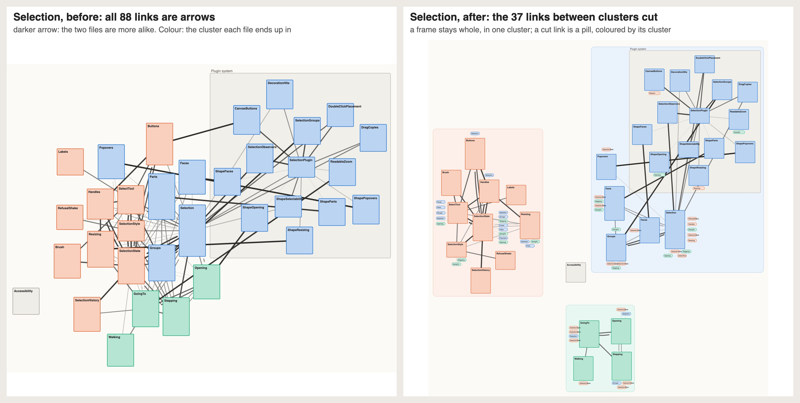
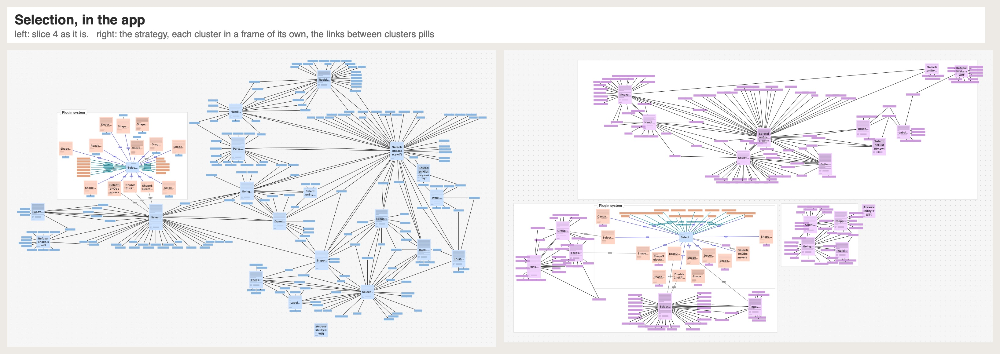
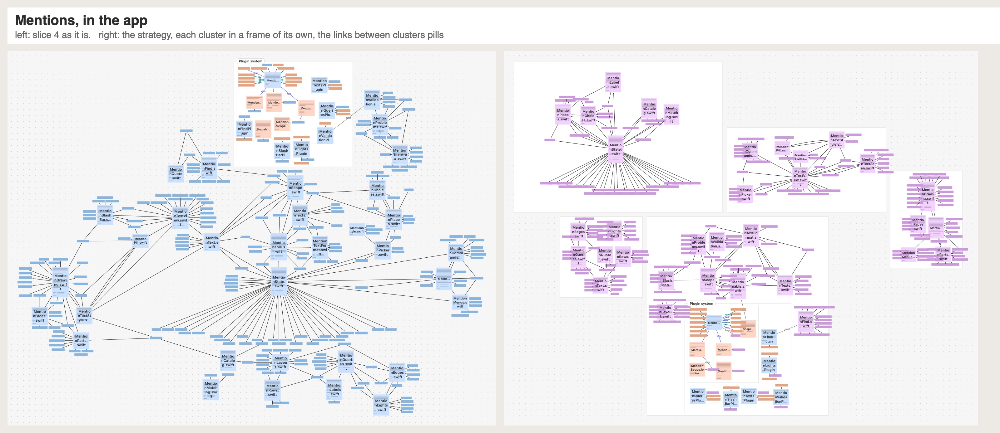
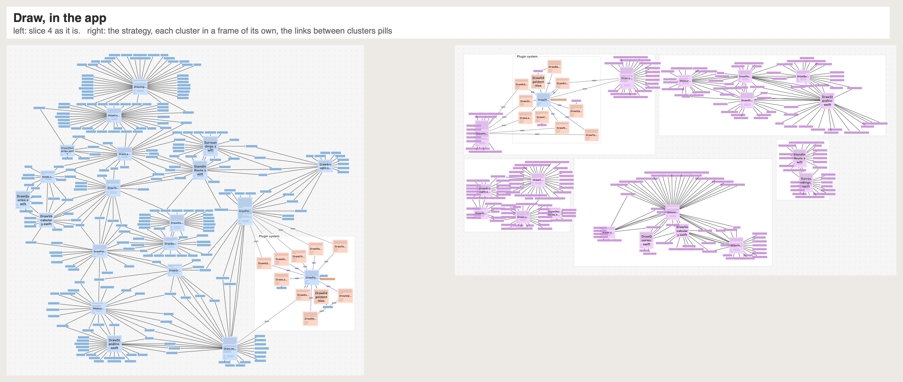
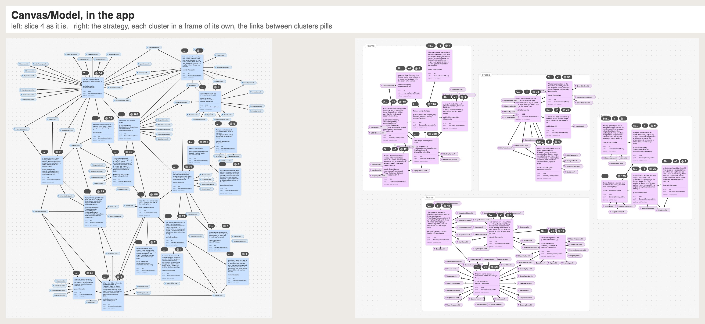
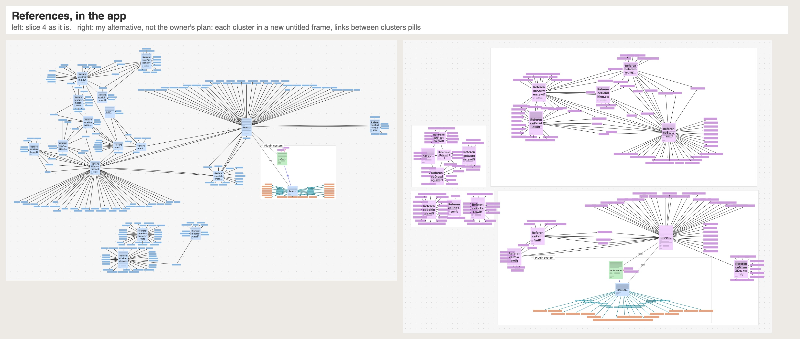
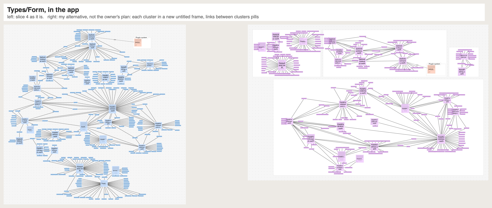

How codebase boards should be laid out: the owner's plan, the questions it leaves open, and where the work stands. An earlier version of this issue presented a different strategy, clusters drawn in new frames, as the owner's. That one is Claude's, and it is kept below, labelled as an alternative.

## The owner's plan, in the owner's words

> first, make proximal by topology. second, make proximal by semantic proximity. we make cuts strategically and algorythmically to move the graph towards decomposed clusters

> topology constrains where nodes can be placed / links exist and they are tighter or looser based on semantics / looser links get cut

> When I told you that the first order concern for deriving node placement was topology, what I meant was the topology already present according to the lens from the codebase ingestion. The secondary source of placement would be semantic.

What that says:

- **Topology first.** Where a note goes is decided first by what the lens already draws: its boards and its frames.
- **Meaning second.** How alike two notes are makes the link between them tighter or looser, and draws them nearer.
- **Cuts.** The looser links become pills, chosen so that the board comes apart into clusters.
- **No new groupings.** Clusters are notes placed near each other inside the lens's own boards and frames. Nothing is drawn around them that the lens didn't make.

## Open, before the respike

The plan leaves these open. Each is the owner's to answer, and nothing that depends on one is built until it is answered.

1. **Topology and links.** Is topology only the lens's boards and frames (where a note may sit), or also its links (linked notes placed near each other)?
2. **How far meaning reaches.** Does meaning act only through links (a tight link pulls its two notes closer, a loose one is cut), or also between notes with no link (alike notes placed near each other anyway)?
3. **Which links get cut.** The spike found groups in each board's links, weighted by meaning (Louvain community detection), and cut the links between the groups. Is that the cut, or another one, such as the loosest links until no arrow crosses another?
4. **"Alike", against the board.** The spike measures how alike two notes are against the rest of their board, so that what every file on a board shares, such as its module's name, counts for nothing. Keep that?
5. **The placer.** Slice 4's engine places the notes on the layout branch: no arrow crosses another, and a link it can't draw becomes a pill. Keep it, or place another way?

## An alternative, not the owner's plan: clusters in new frames

Claude's last spike round clustered each board by meaning and drew each cluster in a new, untitled frame the lens never made. The frames began as a device to make slice 4's engine lay the clusters out as blocks, and were then presented as the owner's idea, which they are not. The owner judged these boards as reading better than slice 4's, and is open to considering this as a strategy of its own.

On all 72 boards it draws with no arrow crossing another. On the six boards below, it keeps 168 of their 557 links as arrows, as many as slice 4, all of them inside clusters.

Six boards in the app: slice 4, and the alternative

## What stands either way

These are the owner's decisions, and they hold whichever way the layout goes:

- **Embeddings are asked through the app.** An engine sits beside the language and decision models. OpenAI's `text-embedding-3-large` answers it first, with its key in Settings, and it can be swapped for another in one place.
- **`canvas measure` answers how alike each link's two notes are**, so canvas-digest gets it with no setup.

Both are built, together with the alternative above, on the layout branch `claude/canvas-layout-strategy-f81c7d`. That branch is local and nothing on it is merged.

## Reproduce

The spike is in [`docs/spikes/semantic-layout`](https://github.com/zekenie/canvas/tree/claude/semantic-layout-spike/docs/spikes/semantic-layout) on branch `claude/semantic-layout-spike`. [`strategy.sh`](https://github.com/zekenie/canvas/blob/d14e44a0247270629a1f441aff626a9f23c8219c/docs/spikes/semantic-layout/strategy.sh) makes the alternative's numbers and the sketch from the folder's data, with no key and no app. The README also keeps the spike's earlier rounds, which tested rules the owner's plan replaced.
